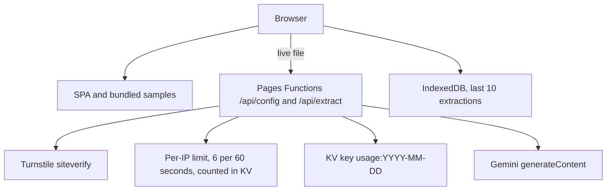
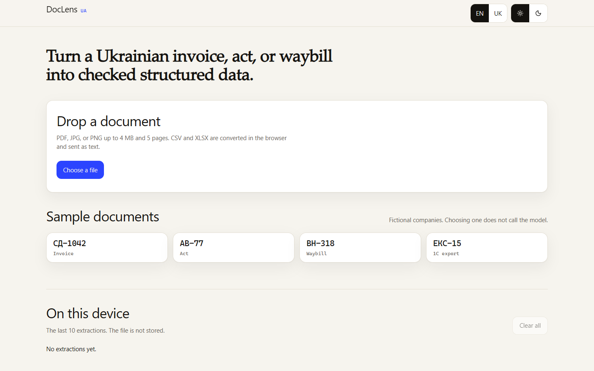
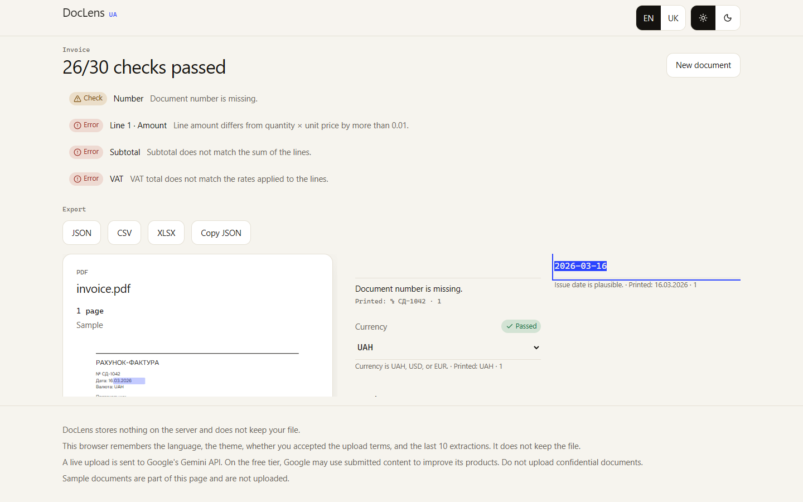
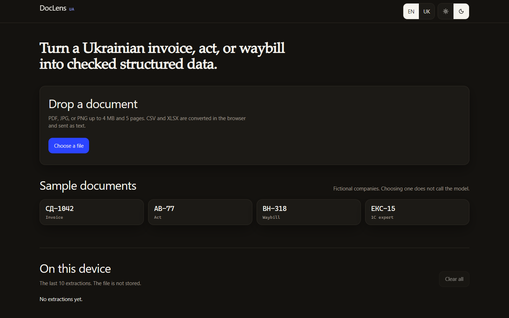
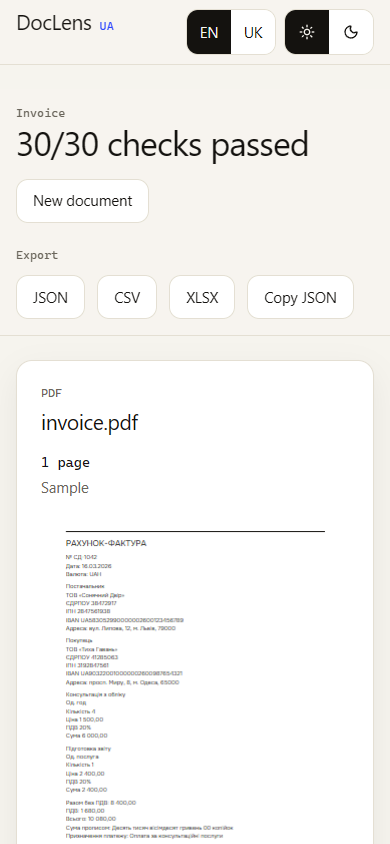

# DocLens UA

DocLens UA turns a Ukrainian invoice, an акт виконаних робіт, a видаткова накладна, or a 1C export into structured fields and then checks the arithmetic, identifiers, date, and amount in words on the device. The model copies what is printed. It does not grade its own accuracy.

The app is a Vite and React single-page app with Cloudflare Pages Functions as the only backend. There is no database and no other server.

## How it fits together



A sample document is fetched from this site and is not sent to the model. A live file goes to `POST /api/extract` only after the free-tier consent checkbox, when that warning applies, and after Turnstile. The Function makes one Gemini call that both classifies the document and extracts it. Zod checks the JSON. The same validators then run again in the browser.

Gemini is called with `fetch`. The request is `POST https://generativelanguage.googleapis.com/v1beta/models/{model}:generateContent` with the header `x-goog-api-key`. The body sends `systemInstruction`, the file as `inlineData` or the spreadsheet as text, and `generationConfig.responseMimeType` of `application/json` with `responseJsonSchema` generated from the Zod schema. `generationConfig.thinkingConfig.thinkingLevel` is sent only when `GEMINI_THINKING_LEVEL` is `minimal`, `low`, `medium`, or `high`.

Checked against Google's "What's new in Gemini 3.6 Flash and 3.5 Flash-Lite" page on 2026-10-16: the model id `gemini-3.5-flash-lite` is a production model, its default thinking level is `minimal`, and the field is `thinking_level`. That page also says `temperature`, `top_p`, and `top_k` are deprecated and currently ignored, and that later models may return an error for them. This Function still sends `temperature: 0`, because that is what the product spec requires, and it retries the same request once without `temperature` if the API returns 400 and the error mentions temperature. That page does not name `responseJsonSchema`. The Function uses that key as specified.

## Interface

Screenshots of the local production build, from `docs/shots/after/`. Light theme unless noted.









On a wide screen the check summary stays put, and the document and the fields scroll on their own. A warning or an error is listed once under the summary. Activating that row focuses the field and highlights the printed phrase when the viewer can find it. There is no demo GIF.

## Run locally

Node 22 or newer.

```bash
npm install
```

Copy `.env.example` to `.dev.vars`. Samples work without a key. Live extraction needs `GEMINI_API_KEY` in `.dev.vars`. The dummy Turnstile values in `.env.example` always pass `siteverify` and are for local development.

```bash
npm run dev
```

Vite listens on port 5173. `wrangler pages dev` proxies it on port 8788. Open `http://127.0.0.1:8788/`.

```bash
npm run typecheck
npm run lint
npm test
npm run build
```

## Eval

`npm run eval` writes twelve fictional documents to `eval/corpus/` and writes `eval/report.md`. HTML is printed to PDF with headless Edge or Chrome. `invoice-scan` is a PNG screenshot of that HTML with a paper texture. Set `DOCLENS_BROWSER` if the browser is not in the usual Windows location. The companies and identifiers are fictional.

The runner calls Gemini one document at a time, waits 5 seconds between documents, and on HTTP 429 waits 20 seconds and then 40 seconds. It uses the same request builder as the Pages Function. It does not go through the Pages rate limit. Field accuracy compares extracted values with the printed ground truth and does not compare evidence strings.

The live run was not done in this workspace because `GEMINI_API_KEY` was not set. The report has no field-accuracy number.

The shared validator did run on the printed ground truth. That is not a model score. One document prints a line amount that is not quantity times unit price. The validator caught that defect.

| Document | Type | File | Validation errors | Planted | Caught |
| --- | --- | --- | ---: | ---: | ---: |
| invoice-classic | invoice | invoice-classic.pdf | 0 | 0 | 0 |
| invoice-narrow | invoice | invoice-narrow.pdf | 0 | 0 | 0 |
| invoice-english | invoice | invoice-english.pdf | 0 | 0 | 0 |
| invoice-vat7 | invoice | invoice-vat7.pdf | 0 | 0 | 0 |
| act-services | act | act-services.pdf | 0 | 0 | 0 |
| act-no-iban | act | act-no-iban.pdf | 0 | 0 | 0 |
| waybill-goods | waybill | waybill-goods.pdf | 0 | 0 | 0 |
| waybill-russian | waybill | waybill-russian.pdf | 0 | 0 | 0 |
| invoice-twopage | invoice | invoice-twopage.pdf | 0 | 0 | 0 |
| waybill-open | waybill | waybill-open.pdf | 0 | 0 | 0 |
| invoice-scan | invoice | invoice-scan.png | 0 | 0 | 0 |
| invoice-bad-math | invoice | invoice-bad-math.pdf | 1 | 1 | 1 |

Planted defects caught on the printed ground truth: 1 of 1.

Put `GEMINI_API_KEY` in the environment or in `.dev.vars` and run `npm run eval` again to fill the model section. The script overwrites `eval/report.md`.

## Privacy and the free tier

The app stores nothing on the server and does not keep the uploaded file. It does not log request bodies or extracted values.

This browser remembers the language, the theme, whether you accepted the upload terms, and the last 10 extractions. It does not keep the file. Clear all wipes those extractions.

When `GEMINI_DATA_TERMS` is `free`, the first live upload asks you to accept this sentence: "This file is sent to Google's Gemini API on a free tier. Google may use submitted content to improve its products. Do not upload confidential documents."

Set `GEMINI_DATA_TERMS` to `paid` to hide that warning. The footer then says that paid-tier terms apply. The setting does not by itself change the contract with Google.

Secrets stay in Cloudflare environment variables: `GEMINI_API_KEY` and `TURNSTILE_SECRET`. They are not in the client bundle.

## Limitations

- Supported types are an invoice, an act, and a waybill. `unknown` drops every field.
- VAT rates that pass are 0%, 7%, and 20%. Currencies are UAH, USD, and EUR.
- An issue date must be a real date from 1 January 1991 through 7 days ahead.
- ЄДРПОУ and ІПН use published community check digits. The State Tax Service has not published official algorithms.
- The amount in words is compared only when the phrase is in the supported Ukrainian, Russian, or English set. Anything else is left unchecked.
- A PDF highlight needs the phrase in the text layer. An image has no text layer, so the viewer quotes the phrase.
- The five-page limit is enforced in the browser. The Function does not parse the PDF structure.
- `xlsx` 0.18.5 has a high-severity advisory for prototype pollution and ReDoS. The spec requires SheetJS, so the package stays. It loads only when a spreadsheet is opened or an XLSX file is saved.
- Lighthouse on the home page of `wrangler pages dev dist`, after this polish pass: performance 95, accessibility 100, best practices 96, SEO 100. The report is `docs/shots/after/lighthouse.json`. Best practices stays at 96 because of one devtools issue with no URL. The page CSP was not weakened to chase it. Before the polish pass the saved repeat was 95, 94, 96, and 91. An earlier performance run scored 98. Performance moves between runs.
- The Gemini field-accuracy run was not done. Do not treat the validator table above as a model score. The polish pass did not change the validators, so the eval was not run again.

## Design notes

The document and its fields are the content. Chrome stays quiet, and each screen has one primary action. The accent color is used for that action and for focus.

Spacing follows an 8 px grid. Type has six sizes, from 12 px to 40 px, and three weights. Onest is the UI face, including the wordmark. JetBrains Mono is used for values, with tabular figures. Source Serif 4 is used only for the landing heading. The spec names that serif for display headings. On the results screen a serif title competed with the numbers, so those titles stay in Onest.

Surfaces use a hairline, a 16 px radius on cards, and one soft shadow. The header is translucent, blurred, and closed with a hairline. Dark mode uses its own surfaces (`#14120F` and `#1C1A16`) and paper-colored text. It is not an inverted light theme.

Status colors keep the spec swatches as tints. Small status text uses darker companions so it clears WCAG AA on the light paper. Passed, warning, and error pills also include the word, not only the color.

Motion uses `cubic-bezier(0.22, 1, 0.36, 1)`, stays under 400 ms, and turns off when the system asks for reduced motion. Buttons settle to a 0.98 scale for 100 ms on press.

## Deploy

1. The usage namespace already exists. `USAGE_KV` in `wrangler.toml` points at it. Pages does not support the Workers rate-limit binding, so the Function counts 6 requests per 60 seconds per IP in that same namespace.
2. The Turnstile widget allows `doclens-ua.pages.dev`. Its site key is `TURNSTILE_SITE_KEY` in `wrangler.toml`. The secret is a Pages secret, not a file in this repo:

   ```bash
   npx wrangler pages secret put TURNSTILE_SECRET --project-name doclens-ua
   npx wrangler pages secret put GEMINI_API_KEY --project-name doclens-ua
   ```

3. Optional variables, already sketched in `wrangler.toml` and `.env.example`: `GEMINI_MODEL` (default `gemini-3.5-flash-lite`), `GEMINI_THINKING_LEVEL`, `GEMINI_ESCALATION_MODEL`, `GEMINI_DATA_TERMS`, `DAILY_CAP` (default 100). `DAILY_CAP` counts each outbound Gemini call, including retries. `0` closes extraction. Leave `GEMINI_DATA_TERMS` as `free` unless the Gemini key is on a paid tier.
4. Deploy:

   ```bash
   npm run deploy
   ```

`wrangler.toml` uses compatibility date `2026-10-12`. Wrangler 4.151.0 rejects `2026-10-16` as a future date.

A request for an unknown path falls through to `index.html`. The rule is in `public/_redirects`.
